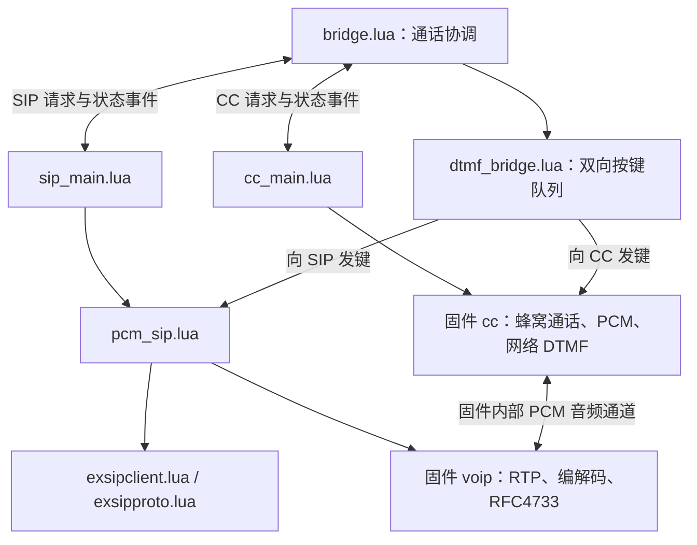

# SIP / CC 双向 DTMF 桥接

入口版本 `1.1.0`。在模组内部通过 PCM 桥接 SIP 和蜂窝语音，同时转发两个方向的网络按键。

## 目录结构与文件关系

本 demo 位于 `module/Air8783H/project/sip_cc_bridge_dtmf/`，包含 12 个 Lua 文件。目录按网络接入和通话业务划分：

```text
sip_cc_bridge_dtmf/
├── README.md                 # 使用说明、配置说明、真机测试与日志判读
├── main.lua                  # 程序入口：加载看门狗、网络与桥接应用，启动 sys 调度
├── netdrv/                   # 网络接入
│   ├── netdrv_device.lua     # 网络选择入口：只启用一种网络驱动，当前为 4G
│   ├── netdrv_4g.lua         # 4G 网络就绪/断网事件处理及 DNS 配置
│   └── netdrv_wifi.lua       # 可选 Wi-Fi 接入，需匹配硬件及 exnetif 依赖
└── sip_cc/                   # SIP / CC 通话和双向 DTMF 桥接
    ├── config.lua            # 集中配置：SIP 账号、呼叫目标、DTMF、媒体、网卡和看门狗
    ├── sip_cc_app.lua        # 启动调度：等待网络，TLS 校时，依次初始化 CC 和 SIP
    ├── bridge.lua            # 通话协调：两侧拨号/接听/挂断、会话隔离、清理及自动发键
    ├── cc_main.lua           # 蜂窝侧状态管理：CC 操作、PCM 就绪/异常检测、启用网络收键
    ├── sip_main.lua          # SIP 侧状态管理：处理桥接请求，将 SIP 回调转换为业务事件
    ├── pcm_sip.lua           # 对接 SIP 公共库与 VoIP 媒体，管理媒体会话及 SIP 侧按键收发
    ├── dtmf_bridge.lua       # 双向按键队列：逐键发送、间隔、完成确认、超时及取消
    └── air153c_wdt.lua       # 可选外置看门狗封装，按 WDT_CONFIG 决定是否启用
```

下列公共库位于仓库的 `script/libs/`，不在 demo 目录内，需按功能加入 Luatools 脚本项目：

| 公共库 | 使用位置 | 职责与加入条件 |
| --- | --- | --- |
| `exsipclient.lua` | `pcm_sip.lua` | 必需；SIP 注册、呼叫信令、对话管理、INFO 收发和媒体协商通知 |
| `exsipproto.lua` | `pcm_sip.lua`、`exsipclient.lua` | 必需；SIP 报文、Digest 鉴权、SDP、编码和 telephone-event 协商等协议处理 |
| `exnetif.lua` | `netdrv_wifi.lua` | 启用 Wi-Fi 时加入，并按实际硬件补齐其网络驱动依赖 |
| `exair153x_wdt.lua` | `air153c_wdt.lua` | 启用外置看门狗时加入，负责底层喂狗波形和周期任务 |

`cc`、`voip`、`socket` 等由底层固件提供。源码按上述目录组织，脚本内部以 `require "config"`、`require "pcm_sip"` 等模块名加载；下载时保持 Lua 文件名，不要混入其他 demo 的同名模块。常用参数集中在 `config.lua`，网络驱动选择在 `netdrv_device.lua`，自动发送的单个按键常量 `DTMF_DIGIT` 位于 `bridge.lua`。

### 启动顺序

1. `main.lua` 检查基础接口，调用 `air153c_wdt.init()`，再加载 `netdrv_device.lua` 和 `sip_cc_app.lua`，最后执行 `sys.run()`。
2. `sip_cc_app.lua` 加载通话模块并注册事件订阅，在任务中等待 `IP_READY`；等待 10 秒超时会记录日志并继续初始化。选择 TLS 时先完成网络校时，校时失败则停止启动。
3. 先执行 `cc_main.init()`，选择 CC PCM 桥接并启用网络 DTMF 接收；再执行 `sip_main.init()`，由 `pcm_sip.lua` 启动 SIP 客户端。通话中的拨号、接听、媒体启停和挂断由各模块继续协作完成。

### 通话、媒体和按键如何协作

下图表示主要运行协作关系；带“事件”的连线通过 `sys.publish/subscribe` 通信，其他连线表示模块调用或标明的音频通道，不是逐行执行顺序或完整的 `require` 依赖图：



- **呼叫控制**：`bridge.lua` 根据两侧通话状态向 `sip_main.lua`、`cc_main.lua` 发出请求；两侧操作结果通过事件返回，协调器决定何时接听另一侧、取消待发键和清理通话。
- **音频传输**：`pcm_sip.lua` 根据 SIP 协商结果启动/停止 `voip`，`cc_main.lua` 管理 CC PCM 状态；音频由固件内部 PCM 桥接和 VoIP 编解码/RTP 通道搬运，Lua 业务层不逐帧复制音频。
- **SIP → CC 按键**：SIP INFO 由 `exsipclient.lua` 处理，RFC4733 由固件 `voip` 处理；两者经 `pcm_sip.lua`、`sip_main.lua` 转成 `SIP_DTMF` 事件，由 `bridge.lua` 校验通话并交给 `dtmf_bridge.lua`，最终调用 `cc.sendDtmf()`。
- **CC → SIP 按键**：固件 `cc` 发布 `CC_DTMF_RX`，`bridge.lua` 校验当前 PCM 会话后交给 `dtmf_bridge.lua`；队列调用 `pcm_sip.send_dtmf()`，按 `dtmf_mode` 选择 SIP INFO 或 RFC4733，并等待匹配的发送完成通知。
- **自动发键**：场景 1 的延时自动 `2` 由 `bridge.lua` 单独调度并调用 `cc.sendDtmf()`；实时双向按键由 `dtmf_bridge.lua` 排队。两者都受当前通话及媒体状态约束。

## 已实测的业务场景

| 场景 | 呼叫与按键流程 | 实测状态 |
| --- | --- | --- |
| 1：接通后自动选菜单 | 软电话 → 模组 SIP 账号 → CC 拨打 `10086`，两侧接通且媒体就绪后延时自动发送一次 `2` | Air780EHV 真机已通过，延时 6000 ms |
| 2：软电话继续操作菜单 | SIP ↔ CC 桥接通话中，软电话拨号盘 → SIP INFO 或 RFC2833/RFC4733 → 模组 → CC 对端 | 真机已通过 |
| 3：手机按键转给 SIP/IVR | 手机 → 模组 SIM → SIP/IVR，接通后手机输入按键，模组逐个转给 SIP 接收端 | 真机已通过，本次场景 3 日志使用 RFC4733 |

以上为 2026-10-31 用户确认的三种业务场景实测结果。INFO、RFC4733 的各方向组合仍应分别记录测试结果，不能由一次通话推定所有组合均已覆盖。

本版本采用“先接通 SIP/IVR，再逐位转发分机号”的方式。分机收号和路由由 SIP 服务器的 IVR 处理。等待 SIP 接通期间手机仍在振铃，不收集分机号。

## 硬件与固件

目录在 Air8783H 项目下，实际硬件仍可使用 Air780EHV / EC718HM，应烧录与硬件匹配的固件。SIM 需开通语音、VoLTE 和数据业务。内部 PCM 桥接不需要本地 ES8311、喇叭、麦克风或回环线。

另外仍需 CC PCM 和 VoIP PCM 桥接能力：`cc.AUDIO_MODE_BRIDGE_PCM`、`cc.bridgePcmStats()`、`cc.bridgeAudioStop()`、`voip.AUDIO_MODE_BRIDGE`、`voip.setAudioMode()`、`voip.pcmIn()`、`voip.pcmOut()`。demo 对缺少接口的固件会明确报错并停止初始化。

## 配置与下载

保留已验收的 SIP 服务地址、端口、域、模组账号、密码、网卡和语音 codec。软电话使用另一个 SIP 账号。

| 配置 | 说明 |
| --- | --- |
| `target_phone_number` | SIP 呼入后固定拨打的蜂窝号码，当前为 `10086` |
| `remote_sip_uri` | 手机呼入时拨打的 SIP/IVR 地址，必须填写真实目标 |
| `auto_handle_mobile_incoming` | `true` 开启手机呼入转 SIP |
| `dtmf_mode` | `auto` 优先使用协商成功的 RTP telephone-event，否则 INFO；`info` 强制 INFO；`rfc4733` 强制 RTP，未协商成功则拒绝发键 |
| `dtmf_duration_ms` | CC/RTP 收键后重发的单键持续时间，100–1000 ms，默认 300 |
| `dtmf_interval_ms` | 相邻按键最小间隔，50–2000 ms，默认 100 |
| `auto_dtmf` | 当前为 `true`，保留场景 1 的自动发 `2`；只测试实时按键时可设为 `false` |
| `dtmf_delay_ms` | 自动发键等待时间，当前已实测值为 `6000` ms；两侧接通且媒体就绪后计时，不影响实时转发 |

`dtmf_mode` 控制 CC → SIP 的发送方式；接收端同时支持 INFO 和 RTP 按键。对端应选择一种发送方式，不要同时发送 INFO 和 RTP 来表达同一次按键。INFO 使用 `application/dtmf-relay`；RTP 使用动态负载类型的 `telephone-event/8000`，事件 0–15（0–9、*、#、A–D），无需把 payload type 固定成 101。不支持纯音频内 DTMF 的识别转发。

Luatools 脚本项目需加入本目录 **12 个 Lua 文件**（包括新增 `sip_cc/dtmf_bridge.lua`），再加入当前仓库的 `script/libs/exsipclient.lua` 和 `script/libs/exsipproto.lua`。保持模块文件名，不要同时加入旧 demo 的同名文件。默认 UDP/4G 无需音频文件、本地 `audio_drv.lua` 或 `exsip.lua`；TLS 需自行提供对应 CA。可选 Wi-Fi、外置看门狗仍按实际硬件配置并加入其依赖。

软电话直接拨 `10086` 时，需要 SIP 服务器将该号码路由到模组 SIP 账号；demo 仍使用固定 `target_phone_number`，未增加任意被叫号码的路由。

## DTMF 接口快速接入

本节面向希望把 DTMF 能力接入自己应用的客户，按“准备通话 → 开启接收 → 发送单键 → 处理结果”说明用法。使用本 demo 时，这些步骤已由 `cc_main.lua`、`pcm_sip.lua` 和 `dtmf_bridge.lua` 完成，按前面的配置即可运行三种场景。

下面是接入片段，需要放入已有的 CC/SIP 通话工程：网络、SIP 注册、拨号/接听和挂断仍由原通话流程管理。同一侧的示例放在同一 Lua 模块内，共享发送请求变量；单键示例不包含多键队列。若扩展本 demo，将业务逻辑合入现有处理函数，避免重复初始化或重复转发。

### CC 侧：向手机/运营商发键，接收手机按键

| 客户要做的事 | 使用接口 | 接口负责什么 |
| --- | --- | --- |
| 准备 CC 音频模式 | `cc.init(0, cc.AUDIO_MODE_BRIDGE_PCM)` | 本 demo 使用内部 PCM 桥接；已有普通 codec 工程沿用其 `cc.init(0)` 和音频配置，不要重复初始化 |
| 开启/关闭网络收键 | `cc.dtmfRx(true / false)` | 成功初始化后、拨号或接听前开启；`false` 关闭并丢弃待交付的接收事件，不挂断电话 |
| 获得对端按键 | `sys.subscribe("CC_DTMF_RX", callback)` | C 层解析后把按键交给 Lua，应用无需自行解析 RTP |
| 向 CC 对端发送一个键 | `cc.sendDtmf(0, digit, duration_ms)` | 异步发送一个网络 DTMF 键，不负责拨号或建立通话 |
| 获得发送结果 | `sys.subscribe("CC_DTMF_TX", callback)` | 按请求编号返回 SDK 受理结果，供应用更新状态、调度下一键 |
| 排查收键状态 | `cc.dtmfRxStats()` | 查看支持、启用、协商和接收计数；它不是取出按键的接口 |

**先注册事件并开启接收。** 以下示例使用 PCM 桥接模式；初始化和 `cc.dtmfRx(true)` 只需在启动阶段执行一次。之后遵循原 CC 就绪流程拨号或接听，不要在通话中才首次开启收键。

```lua
local pending_cc_id

sys.subscribe("CC_DTMF_RX", function(e)
    if e.event ~= "dtmf" then return end -- dtmf_end 是同一键的结束信息
    if e.pcm_session then
        local pcm = cc.bridgePcmStats()
        if not pcm or pcm.session ~= e.pcm_session or
            pcm.active ~= 1 or pcm.media_ready ~= 1 then return end
    end
    log.info("app_dtmf", "CC 收到按键", e.digit)
    -- 在这里收集分机号、处理菜单输入，或交给已有桥接队列。
end)

sys.subscribe("CC_DTMF_TX", function(id, ok, code)
    if id ~= pending_cc_id then return end
    pending_cc_id = nil
    log.info("app_dtmf", "CC 发送结果", id, ok, code)
end)

assert(cc and cc.DTMF_RX_PCM_VERSION == 1, "固件缺少 PCM DTMF 接收能力")
assert(cc.init(0, cc.AUDIO_MODE_BRIDGE_PCM))
local rx_ok, rx_reason = cc.dtmfRx(true)
assert(rx_ok, rx_reason)
```

**通话真正接通后发送。** 将下面代码放到“当前 CC 通话已接通、PCM 已就绪，并且没有上一键等待确认”的业务分支。SIP/CC 桥接时还要等另一侧接通；对接 IVR 时等其开放输入。拨号接口返回成功或正在振铃，都不能作为发键时机。

```lua
local ok, id_or_reason = cc.sendDtmf(0, "2", 300)
if ok then
    pending_cc_id = id_or_reason
    log.info("app_dtmf", "CC 按键已入队", pending_cc_id)
else
    log.warn("app_dtmf", "CC 按键未受理", id_or_reason)
end
```

调用参数和结果：

- `sim_id` 当前填 `0`；`digit` 只能是单个 `0–9`、`*`、`#`、大写 `A–D`，不能把 `"123#"`、电话号码或带逗号的后拨串一次传入。
- `duration_ms` 是整数 `100–1000` 毫秒，省略时为 `300`。持续时间只影响本次发键，不会自动设置多个键之间的间隔。
- 返回 `true, id` 表示成功加入发送任务；返回 `false, reason` 表示未受理，例如上一键尚在处理。受理后通过 `CC_DTMF_TX(id, ok, code)` 判断 SDK 结果，`ok=true` 时 `code=0`。
- SDK 确认不保证按键时长已经全部走完，也不保证远端菜单已响应。连续发送需要同时等待确认、单键时长和键间隔；本 demo 已在 `dtmf_bridge.lua` 中处理。

接收事件 `e` 的字段：

| 字段 | 客户如何使用 |
| --- | --- |
| `event`、`digit` | `event="dtmf"` 时处理一次新按键；`event="dtmf_end"` 时只处理结束信息，不能再次转发这个键 |
| `session` | DTMF 接收会话标识，不是 PCM 会话编号 |
| `pcm_session` | 仅 PCM 模式提供；与当前 `cc.bridgePcmStats().session` 比较，避免处理旧通话事件 |
| `duration_ms`、`duration_ticks`、`clock_hz`、`complete` | 仅 `dtmf_end` 提供；用于观察按键时长及结束是否完整，普通 `dtmf` 事件没有这些字段 |

不再需要接收时调用 `cc.dtmfRx(false)`；正常挂断无需每通重新开关接收，启用状态会跨通话保留。挂断或媒体中断时，业务应清空 `pending_cc_id` 和待发队列，忽略迟到结果。排查收不到键时，可查看 `cc.dtmfRxStats()` 的 `supported`、`enabled`、`mapped`、`rtp_packets`、`events`、`delivered` 等字段，并结合本次通话的计数变化定位。

### VoIP 侧：发送和接收 RFC2833/RFC4733 按键

VoIP 的 DTMF 基于已建立的 RTP 媒体会话。它不负责 SIP 注册或拨号；先由 SIP 客户端完成 SDP 协商，把 `telephone-event/8000` 参数交给 `voip.start()`。仅注册回调或仅有语音通路，并不代表 DTMF 参数已配置。

| 客户要做的事 | 使用接口 | 接口负责什么 |
| --- | --- | --- |
| 启动带 DTMF 的媒体 | `voip.start(options)` | 在已有音频参数中加入协商得到的 DTMF 参数，启用 RTP 按键收发 |
| 接收按键和发送结果 | `voip.on("dtmf", callback)` | 统一回调 `rx`、`rx_end`、`tx_done`、`tx_failed` |
| 获取当前媒体会话 | `voip.getSession()` | 媒体运行时返回会话编号，否则返回 `nil`；发键前获取当前值 |
| 向 SIP/RTP 对端发送一个键 | `voip.sendDtmf(digit, duration_ms, session)` | 按当前会话及协商结果异步发送一个 RFC4733 按键，保持语音运行 |

**先注册回调。** `voip.on("dtmf", ...)` 每种事件只保留一个回调，再次调用会替换原回调。本 demo 已在 `pcm_sip.lua` 注册，应把业务处理合入现有回调或使用其上层 `SIP_DTMF` 事件；下面代码供自行集成 VoIP 的应用使用。

```lua
local pending_voip

voip.on("dtmf", function(e)
    if e.session ~= voip.getSession() then return end
    if e.event == "rx" then
        log.info("app_dtmf", "VoIP 收到按键", e.digit)
        -- 在这里处理一次业务输入，或交给已有桥接队列。
    elseif e.event == "rx_end" then
        log.info("app_dtmf", "VoIP 按键结束", e.digit, e.duration_ms, e.complete)
    elseif e.event == "tx_done" or e.event == "tx_failed" then
        if not pending_voip or e.id ~= pending_voip.id or
            e.session ~= pending_voip.session then return end
        pending_voip = nil
        log.info("app_dtmf", "VoIP 发送结果", e.event, e.id, e.digit)
    end
end)
```

**在已有媒体启动参数中加入协商结果。** 下面的 `options` 是应用原有的 `voip.start()` 参数表，已包含远端 IP/端口、本地 RTP 端口、codec、`ptime=20` 等音频配置；`negotiated` 是本次 SIP/SDP 协商结果。PCM 音频模式也应由原媒体流程准备好。本 demo 的 `pcm_sip.lua` 已完成这些步骤。

```lua
local function start_voip_with_dtmf(options, negotiated)
    options.dtmf_rx_payload_type = negotiated.dtmf_rx_payload_type
    options.dtmf_tx_payload_type = negotiated.dtmf_tx_payload_type
    options.dtmf_clock_rate = negotiated.dtmf_clock_rate
    options.dtmf_events = negotiated.dtmf_events
    return voip.start(options)
end
-- 在原媒体启动位置调用 start_voip_with_dtmf(原媒体参数表, 当前协商结果)，
-- 检查返回值，并等待媒体进入 started、voip.getSession() 返回有效编号。
```

| DTMF 启动参数 | 含义与要求 |
| --- | --- |
| `dtmf_rx_payload_type` | 本端接收的 telephone-event PT，取当前协商结果，范围 `96–127` |
| `dtmf_tx_payload_type` | 本端发送的 telephone-event PT，取当前协商结果，范围 `96–127`；不应假定必然与接收 PT 相同 |
| `dtmf_clock_rate` | 当前实现要求 `8000` Hz；即使语音使用 G.722，也不能直接填语音采样率 |
| `dtmf_events` | 协商允许的事件位掩码，非零整数 `1–65535`；位 0–15 对应 `0–9`、`*`、`#`、`A–D`，全部允许时为 `0xFFFF` |

启用 RFC4733 时必须同时提供有效的收、发 PT、时钟和事件掩码；当前接口不支持只填其中一个 PT。没有协商成功时，不要手工写死 `101` 冒充协商结果。两个 PT 都不配置或都为 `0` 时不启用这条 RTP DTMF 通路。

**通话和媒体就绪后发送一个键。** 以下代码放在已有业务的发键动作中执行，不要刚提交 `voip.start()` 就立即发键；也不要使用上一通保存的会话编号。

```lua
local session = voip.getSession()
if not session then
    log.warn("app_dtmf", "VoIP 媒体尚未运行")
else
    local ok, id_or_reason = voip.sendDtmf("2", 300, session)
    if ok then
        pending_voip = {id = id_or_reason, session = session}
        log.info("app_dtmf", "VoIP 按键已受理", id_or_reason)
    else
        log.warn("app_dtmf", "VoIP 按键未受理", id_or_reason)
    end
end
```

`digit` 同样只能是单个 `0–9`、`*`、`#`、大写 `A–D`。`duration_ms` 为整数 `100–1000` 毫秒，接口默认 `160`；本 demo 显式使用配置时长，当前为 `300`。第三个参数 `session` 必填。返回 `true, id` 后等待同一 `session`、同一 `id` 的结果；同一时刻只允许一个待完成的 RFC4733 发键请求。

| 回调 `e.event` | 客户如何处理 |
| --- | --- |
| `rx` | 收到一个新按键，处理 `e.digit` 一次；此时 `duration_ms=0`，不是“没有收到按键” |
| `rx_end` | 同一接收键的结束信息，含 `duration_ms`、`complete`；不再触发第二次业务输入 |
| `tx_done` | 对应请求的本地网络发送完成；远端 IVR 是否响应仍需接收端确认 |
| `tx_failed` | 对应请求发送失败，停止或按业务策略处理队列，避免盲目重发造成重复键 |

这些 VoIP 回调均带 `digit`、`session`、`id`、`method`、`duration_ms`、`complete`。其中 `rx/rx_end` 的 `id` 标识接收事件，`tx_done/tx_failed` 的 `id` 对应 `voip.sendDtmf()` 返回的请求号，不要混用。

未受理时常见原因：`stale_media_session` 表示媒体已变化或不再运行；`dtmf_not_negotiated` 需检查协商参数、允许事件集及是否只收不发；`invalid_dtmf` 检查单键、时长和会话参数；`dtmf_busy` 表示上一键尚未完成。挂断、`voip.stop()` 或媒体重建后，应用清空 `pending_voip` 和待发队列，再次发键时重新获取会话编号，不要一直等待旧会话的完成通知。

### 把两侧接口用于 SIP/CC 桥接

| 业务需求 | 应用如何组合接口 |
| --- | --- |
| 接通后自动选菜单 | 两侧接通且媒体就绪 → 按 IVR 输入窗口延时 → `cc.sendDtmf()` → 等待 `CC_DTMF_TX` |
| 软电话按键发给手机/运营商 | 收到 VoIP `rx` 或 SIP INFO 按键 → 当前通话的 CC 发送队列 → `cc.sendDtmf()` |
| 手机输入分机给 SIP/IVR | 收到 `CC_DTMF_RX` 的 `dtmf` → 当前通话的 SIP 发送队列 → `voip.sendDtmf()` 或 SIP INFO |

SIP INFO 是另一种 SIP 发键方式，由 Lua 公共库 `exsipclient.dtmf(digits, duration_ms, interval_ms, call_id, request_id)` 处理，不通过 `voip.sendDtmf()`；INFO 收键也不会进入原生 `voip.on("dtmf")`。本 demo 已在 `pcm_sip.lua`、`sip_main.lua` 将 INFO 与 RFC4733 收键统一为 `SIP_DTMF` 事件，并由 `dtmf_mode` 选择向 SIP 发送的方式，业务可复用这条统一处理链。

连续输入 `123#` 时，按 `1`、`2`、`3`、`#` 逐键排队，不要直接循环无间隔调用底层单键接口，也不要在接收回调中阻塞等待发送结果。本 demo 的队列已经处理单键时长、间隔、请求匹配、超时和挂断取消；修改业务时保持这些处理，再用后面的三种场景进行验收。

## 转发与生命周期

- 只在两侧接通、媒体就绪且属于当前通话时收取业务按键；早期媒体、振铃和挂断期间不转发。
- SIP INFO 按当前 dialog、双方 tag、CSeq 校验；重传只重发响应，不重复转发按键。
- RTP 按协商的 PT、事件集、来源和媒体会话处理；重复结束包不会产生重复按键。`rx_end` 只用于持续时间信息，demo 不二次转发。
- CC 网络接收在 PCM 桥接中启用；事件的 `pcm_session` 必须匹配当前桥接会话。普通 codec 接收能力保留。
- 每个方向各有最多 32 个待发按键，逐键发送。按键时长和间隔受限；长按会转换为一个按键，不保持无限长音。INFO 提供的时长限制到 100–1000 ms。
- CC 和 RTP 收键使用 `dtmf_duration_ms` 重发，不依赖结束包到达。INFO、CC、RTP 的完成确认分别按请求标识和通话绑定。
- 挂断或媒体中断立即丢弃待发按键；已发到网络的按键不能撤回。确认超时不重发，停止本通当前媒体阶段该方向后续按键并记录 `RELAY_FAILED`，避免产生错号。
- `RELAY_SENT`、`DTMF_SDK_ACCEPTED` 只表示本地发送或协议/SDK 确认，不证明远端 IVR 已执行。

## 真机验收

### 测试准备

1. 准备已烧录匹配固件和本 demo 脚本的 Air8783H/Air780EHM、可用的模组 SIM、一部普通手机，以及已注册的 SIP 软电话或 SIP/IVR 测试接收端。
2. 确认启动日志为 `SIP_CC_BRIDGE_DTMF 1.1.0`，能力检查、CC 初始化和 SIP 注册成功。继续使用已验收的 PCMA、20 ms 配置，先完成按键验证。
3. 在 `sip_cc/config.lua` 中核对下述测试字段。以下均是现有配置表中的字段示例，不要替换整份配置；修改后重新下载脚本并重启。保留已能正常注册的 SIP 参数。
4. Luatools 从呼叫开始前持续保存日志，直到挂断和旧通话清理完成。SIP 接收端同时记录 DTMF；若使用 IVR，预先配置有效菜单和测试分机。
5. 首轮每次按键间隔约 1 秒，先确认顺序与接收结果，再进行快速按键、长按等边界测试。一次按键只选一种 SIP DTMF 发送格式。

### 场景 1：软电话呼叫 10086，接通后自动发送一次 2

流程：`软电话 → SIP 服务器 → 模组 → CC 拨打 10086 → 自动发 2 → 10086 菜单响应`。

配置：

```lua
target_phone_number = "10086",
auto_dtmf = true,
dtmf_delay_ms = 6000,
dtmf_duration_ms = 300,
```

操作步骤：

1. 软电话拨打模组 SIP 账号；若软电话直接拨 `10086`，先在 SIP 服务器配置该号码到模组账号的路由。模组实际拨出的号码由 `target_phone_number` 决定。
2. 等待 10086 接通并听到语音提示。全程先不要操作软电话拨号盘，避免与自动键混淆。
3. 观察 `AUTO_DTMF_WAIT`，其中应为 `digit 2`、`delay_ms 6000`。在两侧接通、媒体就绪后等待约 6 秒，随后应出现 `DTMF_SUBMITTED` 和 `DTMF_SDK_ACCEPTED`。
4. 收听 10086 是否进入按 `2` 对应的菜单；继续保持通话，确认同一通话没有再次自动发送 `2`，双向语音仍正常。
5. 挂断后重新拨打一次，确认新通话仍会自动发送一次 `2`。

验收标准：无人手动按键时，自动键每通仅发送一次，远端菜单实际响应，语音和挂断正常。

本轮已用 **6000 ms** 验收通过。自动发键按固定延时执行，不识别运营商提示音；不同地区的 10086 可能在开场播报期间不接收按键。若本地已报 `DTMF_SDK_ACCEPTED` 但菜单未响应，可在同一通电话等到“请按……”后手动按一次 `2`。若手动有效，应根据该 IVR 的输入窗口调整 `dtmf_delay_ms`，不能仅凭 SDK 成功就认定菜单已切换。

### 场景 2：通话中用软电话拨号盘继续操作 CC 对端

流程：`软电话拨号盘 → SIP INFO / RFC4733 → 模组解析 → cc.sendDtmf() → 10086 或其他 CC 对端`。

配置与前提：

- 可紧接场景 1，在同一通电话完成自动选菜单后继续测试。
- 若单独测试手动按键，将 `auto_dtmf = false`，避免自动 `2` 改变菜单位置；该设置不关闭实时转发。
- 软电话选择 SIP INFO 或 RFC2833/RFC4733。`config.dtmf_mode` 控制模组向 SIP 发键，不能用它代替软电话的发送模式设置。

操作步骤：

1. 按场景 1 的呼叫方式建立 SIP ↔ CC 通话，等待语音和媒体就绪。
2. 等待对端提示可输入，使用软电话的通话中拨号盘按一个当前菜单有效的数字。例如菜单提示按 `2` 时按 `2`。
3. 日志应依次出现 `RELAY_SUBMITTED SIP_TO_CC 2 CC ...` 和 `RELAY_SENT SIP_TO_CC 2 ...`。同时确认远端菜单产生对应变化。
4. 按新的菜单提示继续选择下一层，确认连续多个按键均有效。需要核对完整的 `0–9`、`*`、`#` 时，改用具备收键日志的测试 IVR，避免真实客服菜单提前跳转或结束通话。
5. 软电话切换为另一种 DTMF 模式，重新建立一通电话，重复上述测试。RFC2833/RFC4733 测试还应确认 SDP 协商了 `telephone-event/8000`。

验收标准：手动按键与 CC 对端响应一一对应，顺序正确、没有额外按键，发键过程中语音持续正常。不能只用软电话本地听到的按键音判断转发成功。

### 场景 3：手机拨打模组 SIM，输入按键或分机号给 SIP/IVR

流程：`手机 → 模组 SIM 来电 → 模组呼叫 SIP/IVR → SIP 接通后接听手机 → 手机按键 → SIP/IVR`。

配置：

```lua
auto_handle_mobile_incoming = true,
remote_sip_uri = "sip:ivr@example.invalid", -- 示例占位，替换为实际可达的 SIP/IVR 地址
dtmf_mode = "auto",
dtmf_duration_ms = 300,
dtmf_interval_ms = 100,
```

`remote_sip_uri` 可以先指向能查看 DTMF 接收事件的测试终端，再指向真正的 IVR。普通软电话若只显示通话界面、不能显示收键结果，需要结合接收端日志或抓包判断。`auto_dtmf = true` 可以保留，它只用于 SIP 呼入触发 CC 外呼的场景，不会在本场景额外插入自动 `2`。

操作步骤：

1. 普通手机拨打模组 SIM 的手机号码。此时模组向 `remote_sip_uri` 发起 SIP 呼叫，日志出现 `呼入场景：拨打 SIP`。
2. 由 SIP 终端接听或由 IVR 自动应答。随后模组接听手机来电，日志出现 `执行接听` 和 `CC 已接通且 PCM 通道就绪`。等待手机听到 SIP/IVR 语音后再输入按键；手机仍在振铃时不收集分机号。
3. 先做收键测试：在测试接收端准备好后，手机依次输入 `123#`，首轮每键间隔约 1 秒。确认接收端按顺序得到 `1`、`2`、`3`、`#`，每键仅一次。
4. 若本通协商了 RFC4733，每键应有如下日志链。INFO 模式的提交日志会显示 `INFO`，成功确认来自对应的 SIP INFO 请求。

   ```text
   RELAY_SUBMITTED CC_TO_SIP 1 RFC4733 <请求编号>
   event dtmf tx_done
   RELAY_SENT CC_TO_SIP 1 nil
   ```

5. 再做分机业务测试：把目标设为已配置收号规则的 IVR，拨通后按提示输入真实分机号。例如 IVR 配置为用 `#` 结束输入时，可输入 `123#`；确认分机 `123` 振铃，接听后能双向通话。`123` 仅为示例，结束键及分机路由以服务器规则为准。
6. 分别由手机侧、SIP 侧主动挂断各测试一次，确认另一侧也结束通话；待清理完成后再拨通，验证可以继续收键。

验收标准：手机按键、模组转发记录、SIP 实际接收结果三者一致；使用 IVR 时还应成功进入对应菜单或分机。模组只逐位转发，不在本地拼接分机号，也不负责分机路由。

本轮场景 3 的 RFC4733 日志共记录 **29 次提交、29 次 `tx_done` 和 29 次 `RELAY_SENT`**，编号及键值顺序匹配，未见发送失败或超时。用户已确认三种场景均正常；该记录可作为后续版本对照，不能替代其他部署环境的接收端验证。

### INFO / RFC4733 分别验证

切换配置后使用新通话测试，并分别记录结果：

| 测试项 | 设置方式 | 核对点 |
| --- | --- | --- |
| 场景 2 / INFO | 软电话发送模式设为 SIP INFO | INFO 使用 `application/dtmf-relay`，CC 对端只收到一次对应按键 |
| 场景 2 / RTP | 软电话发送模式设为 RFC2833/RFC4733 | SDP 协商 telephone-event；重复的 E 结束包不产生额外 CC 按键 |
| 场景 3 / INFO | 模组 `dtmf_mode = "info"`，SIP 接收端支持 INFO | 接收端按顺序处理对应 INFO 按键 |
| 场景 3 / RTP | 模组 `dtmf_mode = "rfc4733"`，SIP 接收端允许 telephone-event | 接收端识别正确事件、时长和结束标志，每键只处理一次 |
| 场景 3 / 自动选择 | 模组 `dtmf_mode = "auto"` | 有协商结果时提交日志显示 `RFC4733`；未协商时使用 `INFO`，对端须支持 INFO |

`auto` 按 SDP 协商结果选择发送方式，不是在 RTP 发送失败后自动重发 INFO。强制 `rfc4733` 而未协商成功时，应看到拒绝原因 `telephone_event_not_negotiated`，不能把该次按键记为通过。

若 SIP 服务器仅转发信令、媒体直接发给另一终端，应在实际 RTP 接收端检查按键；纯 SIP 代理没有收到 RTP 包不代表转发失败。

## 类似实用场景与建议补测

以下是可基于现有桥接能力继续验证的应用方式，尚不属于上面三项实测结论。需要的菜单、收号和业务规则均应先在对端配置。

| 应用场景 | 测试方式 | 验收重点 |
| --- | --- | --- |
| 自动进入首级菜单，再人工办理业务 | 保持自动 `2`，先确认菜单切换，再从软电话手动选择后续菜单 | 自动键只有一次，后续人工键顺序正确；首轮不要在自动键发送时同时按键 |
| 手机接入企业总机 | 将 `remote_sip_uri` 指向企业 IVR，手机拨模组 SIM 后输入部门或分机号 | IVR 收号正确，目标分机振铃，接听后双向通话正常 |
| 手机接入 SIP 语音会议 | 将 `remote_sip_uri` 指向支持 DTMF 入会的会议入口，手机按提示输入测试会议号及结束键 | 会议系统正确收号并进入预期会议；会议功能由服务器提供 |
| 远程操作其他固定语音服务 | 将 `target_phone_number` 改为测试服务号码，关闭自动 `2`，软电话按提示逐级选菜单 | 每一级菜单响应正确；这仍是固定目标拨号，不是任意号码路由 |
| 双向按键联调 | 将 CC 目标设为测试手机、SIP 端使用能显示收键事件的终端，桥接接通后两侧轮流按键 | 分别出现 `SIP_TO_CC`、`CC_TO_SIP`，并由对应接收端核对；手机若不显示收到的 DTMF，应配合可观测的 CC 测试端 |

建议在可记录完整按键的测试终端上补测以下边界，两个方向分别执行：

| 测试 | 操作 | 预期 |
| --- | --- | --- |
| 完整拨号盘 | 输入 `123456789*0#` | 12 个键顺序完全一致，无漏键、重复键 |
| 同键连按 | 输入 `11#`、`00*#` | 两次独立按压被识别为两个键，不因去重合并 |
| 长按 | 单次持续按住一个键再松开 | 转发一个受限时长的按键；不承诺保留原始长按时长 |
| 快速短串 | 连续输入 `123456#` 后等待队列发送完成 | 对端仍按原顺序收到全部键；正常用例不出现队列满或确认超时 |
| 通话中边说话边按键 | 双向通话时交替按键 | 收键正确，语音没有持续中断或卡顿 |
| 排队期间挂断 | 快速输入短串后立即挂断，再建立新通话 | 未发送队列取消，旧键不进入新通话；挂断前已发到网络的键不能撤回 |
| 自动键等待期间挂断 | 场景 1 在 6 秒等待结束前挂断 | 自动键取消，不在本通挂断后或下一通提前发送 |
| 任一侧挂断及快速重拨 | 分别由 SIP、手机主动挂断，再立即重拨 | 两侧正确释放；遵守清理和呼叫间隔后可再次通话，无旧媒体或旧按键串入 |

队列容量为每方向最多 32 个待发键，不适合无限速灌入按键。以上快速输入测试应使用短串；如专门测试超限，预期应看到 `RELAY_DROPPED ... queue_full`，不能要求超出队列容量的键仍全部送达。

## 日志判读与问题定位

| 日志或现象 | 含义与检查方法 |
| --- | --- |
| `AUTO_DTMF_WAIT` → `DTMF_SUBMITTED` → `DTMF_SDK_ACCEPTED` | 自动键完成本地提交及 SDK 确认；还需收听远端菜单是否实际响应 |
| `RELAY_SUBMITTED` → `RELAY_SENT` | 当前按键本地发送完成；结合方向、键值和实际接收结果判断，不等于 IVR 已执行业务 |
| `RELAY_SENT CC_TO_SIP ... nil` | RFC4733 成功路径没有错误原因，最后一项打印为 `nil`，不表示失败 |
| RFC4733 的 `tx_done` | 包含结束包在内的本地网络发送完成，不是远端 RTP 收键确认 |
| 按键期间 `tx_pps` 高于平时 | 语音和 RFC4733 事件包共用发送统计；本次语音约 50 包/秒，按键期间增加、停止后恢复，属于正常现象 |
| `ul_prebuffer_silence` 非零但不增长 | 预缓冲阶段主动填充静音的累计数，不是丢包数。本次固定为 28，且 `ul_underflows`、`ul_lost` 为 0；其他通话不要求固定为 28 |
| `DTMF_SUBMIT_FAILED` / `DTMF_SDK_REJECTED` | 自动键提交或 SDK 确认失败，记录原因或返回码，并检查 CC 通话状态 |
| `RELAY_REJECTED` / `RELAY_FAILED` / `RELAY_DROPPED` | 分别检查拒绝原因、发送确认失败或超时、队列满等原因。先定位故障，不以本地按键音作为成功依据 |
| 挂断时 `RELAY_CANCELLED` / `AUTO_DTMF_CANCELLED` | 取消待发键或自动键等待是预期行为；通话未结束时出现则需检查媒体为何中断 |
| 模组显示发送成功，但 IVR 没有反应 | 检查 IVR 是否开放输入、当前菜单规则、SIP DTMF 模式、SDP 协商和实际媒体接收端日志 |

媒体健康检查关注 RTP 的 `tx_errors`、`rx_bad_payload`、`rx_queue_dropped`、`rx_out_of_order`、`rx_decode_dropped`，以及 CC PCM 的 `ul_lost`、`ul_underflows`、各类 dropped 等计数。正常测试中应没有新增异常；单凭发送和接收包总数不同不能判断丢包。

手机主动挂断的正常顺序示例为：CC `DISCONNECTED` → SIP BYE → 200 OK → `sip_idle`。继续记录到 `旧通话清理完成`，再结合下一通可正常拨通验证释放结果。记录问题时保留按键时间、预期键序、实际接收键序及两端日志；对外分享前去除账号、鉴权内容和真实号码。

通过标准是远端菜单/分机实际响应正确、顺序正确、无重复键、音频正常且可再次拨通。主机回归不替代运营商网络和真机验证。

RTP 实现参考 [RFC 4733](https://www.rfc-editor.org/rfc/rfc4733.html)。当前实现范围为协商的 8000 Hz DTMF 事件，不包括 RFC 2198 冗余封装和其他电话事件。
